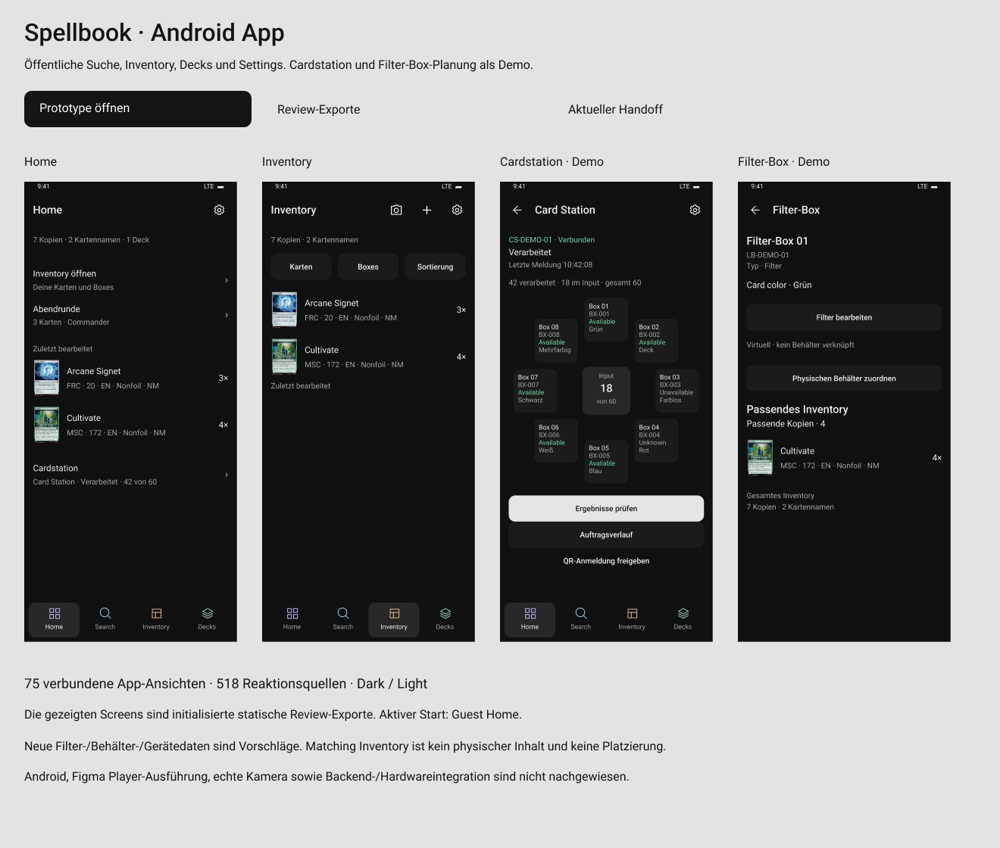

# Spellbook website and Android design handoff

- Status: Android first slice implemented; native target verification pending
- Last Reviewed: 2026-10-19
- Source of Truth: maintainer's selected Android structure and Figma-first sequence, inspected first-party app images and versioned mobile source, linked Figma files and shared API contracts
- Update Triggers: accepted visual direction and Card Station demo name, independent web/backend/Android delivery, native stack recommendation, prototype journey review, colored app navigation and compact Inventory actions, eight-box Cardstation and proposed Filter-Box/physical links, Cardstation/capture contracts, framework selection, API parity, native session lifecycle and cache policy
- Related Docs: [UI direction](./ui-design-direction.md), [Routes](./routing-and-games.md), [System overview](../architecture/system-overview.md), [Mobile and Scan](../architecture/mobile-and-scan.md), [Auth](../architecture/auth.md), [Cardstation proposal](../integrations/card-robot.md), [Client evaluation](../integrations/scanner-platform-evaluation.md), [ADR-0023](../decisions/0023-local-recognition-in-scanner-clients.md), [Product index](./README.md)

The maintainer selected a separate Android application against the shared backend.
On 2026-10-19, the maintainer requested a complete clickable Figma prototype before native implementation in a separate application directory.
The earlier mobile scaffold and isolated T3 comparisons did not establish the required overall experience.
This handoff owns the replacement app structure.
Kotlin/Compose is selected in [ADR-0024](../decisions/0024-independent-applications.md).
The [implementation contract](../architecture/independent-applications.md) owns the independent runtime extraction and first native acceptance.

## Figma files and current entry

| File                                                                                     | Scope                                                                                                                                             |
| ---------------------------------------------------------------------------------------- | ------------------------------------------------------------------------------------------------------------------------------------------------- |
| [Spellbook](https://www.figma.com/design/aKZ8f01JvXu68PAOIeevbw/Spellbook?node-id=42-2)  | Active overview, coherent Android journeys, source references and implementation handoff. Earlier drafts remain identified as superseded history. |
| [Spellbook Cardstation](https://www.figma.com/design/mvLCjFJobIjv1gPKOi6b31?node-id=2-2) | Public website Landing page and short reference handoff only. The Android prototype contains the separately requested mobile Cardstation views.   |

The [Android prototype](https://www.figma.com/proto/aKZ8f01JvXu68PAOIeevbw/Spellbook?page-id=61%3A178&node-id=63-128&starting-point-node-id=63%3A128&scaling=scale-down&content-scaling=fixed) starts at guest Home.
For the contextual Auth journey, find Sol Ring, choose a Printing and prepare an Inventory Add.
Login or Registration returns to the unsaved draft; Save remains explicit.

These are initialized static review previews.
The linked prototype contains the connected frames and state bindings.
Cardstation and capture use demo data.
On 2026-10-19, the maintainer accepted this visual direction for implementation and renamed the example device from Atelier to Card Station.
This does not establish native or hardware acceptance.

## Selected app structure

Home, Search, Inventory and Decks are the four main destinations.
Root views use compact toolbars and a directly reachable Settings gear.
Search puts its field in the toolbar.
Large Spellbook wordmarks, filled avatar buttons and website chrome do not belong in this app.
Details have Back, an object title and contextual actions.
Focused tasks have explicit finish/cancel controls and omit the tab bar.
Settings returns to its originating context.

Home shows compact collection data, recent objects and a Cardstation entry.
Settings contains account actions, appearance, QR authorization, Cardstation and About.
The mobile design uses Android system typography, restrained neutral surfaces, consistent controls and card artwork within card content.
This supersedes the earlier mobile font/avatar treatment.
Website fonts and layout remain their own accepted design.

The four tab icons reuse the website's geometry and distinct Home, Search, Inventory and Deck colors in both themes.
Inventory has compact Camera, Plus and Settings actions with 48dp targets.
Plus opens the existing Add flow; phone capture belongs in Inventory and returns there.
Home has no capture shortcut or large Add-cards action.

## Connected journeys

| Journey                  | Required prototype behavior                                                                                                                                                                                            |
| ------------------------ | ---------------------------------------------------------------------------------------------------------------------------------------------------------------------------------------------------------------------- |
| Public Catalog           | Guest Search, filters, supported Printing choice, details and preserved query/context on return.                                                                                                                       |
| Contextual account entry | A prepared Add draft opens Login or Registration. Success returns to the same UNSAVED draft, followed by explicit Save. Direct/private destination entry resumes the requested context. Login never mutates Inventory. |
| Inventory                | Cards, Boxes, details, Quantity/Notes edit, group assignment, confirmation before removal and consistent counts/receipts. Printing, Finish and Condition identify an entry and remain fixed during entry editing.      |
| Decks                    | Create, Search/add to an explicit Deck and role, quantity/role edits, Availability, import preview/correction and export. Requirements remain separate from owned quantities.                                          |
| Settings and QR          | Settings return, account/logout, and scan/manual QR request inspection with explicit Approve/Deny and expiry recovery. A new account and logout must not expose another account's records.                             |
| Cardstation and capture  | Device selection/status views and a future single-card capture/correction/confirmation journey, using identified demo data and no automatic ownership changes.                                                         |

Meaningful loading, empty, failed-read and unconfirmed-save examples preserve inputs and task context.
A failed read is not an empty success.
Save needs a confirmed result.
All visible prototype actions need an intentional destination or an explicit unavailable state.
Figma input choices are simulations, not native forms.

## Cardstation boundary

Home and Settings open the same Cardstation area.
The selected circular view has eight tappable box positions around a central input stack.
It shows device name/ID, connection/activity, observation time and each recognized box's coarse Filter and availability.
Details distinguish last reported device configuration from a draft.
Stale or failed observations remain explicit.
Device registry, jobs and result data are proposals; processing never implies new Inventory ownership.
No motor Start/Stop controls are selected.
Eject's location and routing in this new geometry remain open.

The existing manual Inventory Box flow remains.
Separate Filter-Box examples explore card-colour or selected-Deck matching, preview/confirm/cancel, and an optional physical-box ID link.
Logical Box ID, physical container ID and device position stay distinct; a Box may remain virtual.
Overlapping matches do not add owned copies.
Matching Inventory does not prove physical content, and a new filter does not silently activate on the device.
[The Cardstation proposal](../integrations/card-robot.md#current-app-geometry-and-box-proposal) owns this extension and its unresolved matching, allocation and activation policies.
No automatic grouping service or new API is implemented.

The existing QR contract authorizes an ordinary account session.
Success says Anmeldung freigegeben.
It does not enroll a device or implement monitoring/synchronization.
Sample data and missing integration contracts are annotated outside phone screens.
Local recognition and Jetson-owned execution follow [ADR-0023](../decisions/0023-local-recognition-in-scanner-clients.md).
The website's paused Scan presentation does not prohibit this commissioned Android design simulation.

## T3 Code Android follow-up

Actual Android phone images from [T3 Code's official Store listing](https://play.google.com/store/apps/details?id=com.t3tools.t3code) and source commit `1451e7cb23034d29774338608368a15d8845df36` inform the overall composition.
Useful owners include its [Compose App Bar](https://github.com/pingdotgg/t3code/blob/1451e7cb23034d29774338608368a15d8845df36/apps/mobile/src/components/ui/NativeAppBar.android.tsx#L1-L40), [Settings entry](https://github.com/pingdotgg/t3code/blob/1451e7cb23034d29774338608368a15d8845df36/apps/mobile/src/features/home/ThreadListToolbar.tsx#L102-L149), [keyboard-first Back](https://github.com/pingdotgg/t3code/blob/1451e7cb23034d29774338608368a15d8845df36/apps/mobile/src/features/home/ThreadListToolbar.tsx#L53-L86) and [Android sheets](https://github.com/pingdotgg/t3code/blob/1451e7cb23034d29774338608368a15d8845df36/apps/mobile/src/components/ui/Sheet.android.tsx#L9-L28).
Store captures show Light Mode and are not revision-matched to that source.
T3's React Native implementation does not select Spellbook's framework.

Other inspected references are [Letterboxd Android](https://letterboxd.com/crew/story/huge-update-to-our-android-app-is-out-now/) for artwork, [ManaBox](https://www.manabox.app/) for card rows and [Pocket Casts Search](https://blog.pocketcasts.com/2025/11/18/search/) for search/result hierarchy.
Product images establish visible composition, not conversion, performance or Spellbook usability.

## Native implementation handoff

The selected next delivery separates the Svelte website, backend and Android application in one monorepo.
Keep the existing frontend/backend/contracts owners and add a separate Android project.
[System overview](../architecture/system-overview.md#selected-independent-applications) owns the deployment transition.
The integrated application backend is an independent TypeScript/Node HTTP process; Python owns the existing worker packages.
A Go or Python application-backend rewrite is not selected.

The selected framework is Kotlin with Jetpack Compose for Android-first delivery.
Use the accepted Figma components, Navigation 3, ViewModel/StateFlow and lifecycle-aware state collection, following [Android's architecture guidance](https://developer.android.com/topic/architecture/recommendations).
Ktor Client with the OkHttp engine and kotlinx.serialization can handle HTTP and the existing [SSE invalidations](https://ktor.io/docs/client-server-sent-events.html).
[CameraX](https://developer.android.com/media/camera/camerax) is the proposed later capture adapter; QR decoding and MTG recognition need their own implementations.
[The reviewed implementation contract](../architecture/independent-applications.md#android-delivery) pins the compatible toolchain and initial native scope.

React Native/Expo remains the strongest alternative if near-term iOS delivery becomes required.
It adds React alongside Svelte but can share mobile implementation across Android and iOS; [Expo Camera](https://docs.expo.dev/versions/latest/sdk/camera/) supports camera and barcode workflows.
Kotlin adds a separate language/Gradle toolchain and does not itself deliver an iOS app.
Both can implement the accepted visual design.

The selected first delivery is online-first.
Use bounded read/image caches and local drafts scoped by backend, account and target.
Respect Catalog generation/revision and HTTP no-store contracts.
Refresh private reads after mutation and resume.
Keep secure session storage, reauthentication and logout separate from draft persistence.
No offline mutation queue, CRDT or implicit resubmission is selected.

DataStore is the proposed owner of small settings; use Room only when structured drafts or permitted cache queries need it.
Neither is a secret store.
Keep session ciphertext in app-private storage with its encryption key protected by [Android Keystore](https://developer.android.com/privacy-and-security/keystore).
The implementation contract owns dependency versions, retention limits and session lifecycle.

Public single-Printing lookup, web/API parity and initial native session/lifecycle requirements are covered by the [reviewed implementation contract](../architecture/independent-applications.md).
App Links, local recognition assets and Cardstation registry/jobs/sync need their own contracts.
Existing mutation authority stays in the backend.
The first native slices should exercise public Search/Printing, contextual Auth with draft retention, acknowledged Inventory changes visible on the website, then Deck editing/Availability.

Rendered screens, saved Figma reactions and simulated scenarios do not prove Player execution, Android keyboard/Back, accessibility, real authentication, physical capture or hardware integration.
Maintainer visual acceptance covers the design direction; native verification remains separate work.

The selected toolchain pins SDK 37, AGP 9.1.1, Gradle 9.6.1, Kotlin 2.4.21 and Compose BOM 2026.09.00, with Navigation3, Lifecycle, Activity and Ktor versions in the [contract](../architecture/independent-applications.md#android-delivery).
The native source is integrated, and debug assembly, JVM unit tests and lint passed in the parent checkout.
The root-owned emulator attempt exited 139 before boot.
Per maintainer instruction, no workaround was attempted.
Install, rendered UI, real API native journeys and website-to-app SSE remain unexecuted.
No physical Honor, camera, hardware or production deployment acceptance is established.
